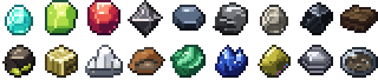
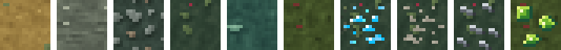
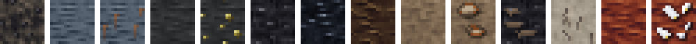
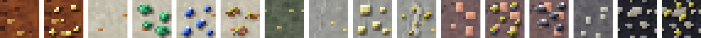

<h1 align="center">RealisticOres</h1>

<p align="center">
  
</p>

<p align="center">
  <strong>Ores sit in deposits that form the way the real ones do.</strong><br>
  Diamonds in kimberlite pipes, coal in sedimentary basins, copper in porphyry. Read the land, pan the rivers, follow the trail.
</p>

<p align="center">
  <a href="https://github.com/Wirezat/realisticores/actions/workflows/build.yml"></a>
  
  
  
</p>

---

Vanilla ores come as scattered blobs that tell you nothing. In RealisticOres an ore belongs to a **deposit**: a body of rock with zones, a shape and a story you can read from the surface. Find the deposit and you find the ore. Every deposit and every ore can be switched in the config.

## Highlights

- **[Kimberlite pipes](#kimberlite-pipes)**: carrot-shaped volcanic pipes with craters, five kimberlite facies and a peridotite rim. Diamond, bort, graphite and peridot, with rich, poor and barren pipes.
- **[Coal basins](#coal-basins)**: layered basins of hard coal, lignite or anthracite, with sandstone and uranium roll fronts, pyritic black shale, clay ironstone and burning seams.
- **[Porphyry copper](#porphyry-copper-in-progress)** (in progress): zoned copper rock from gossan cap to potassic core.
- **[Prospecting](#prospecting)**: pan sediment for indicator minerals, follow their trail upstream, buy a map to the nearest field.
- **[Crystal press](#crystal-press)**: press graphite into synthetic diamond, faster and richer with the right catalyst and a seed crystal.
- **[Plays well with others](#compatibility)**: enabled ores suppress same-tagged ores of vanilla and other mods; every resource carries `c:` tags, a storage block and an armor trim colour.

## Deposits

### Kimberlite pipes



Pipes cluster in fields on old continental crust. Each pipe narrows with depth and changes facies from top to bottom: weathered kimberlite at the surface, volcaniclastic kimberlite and breccia in the crater, hypabyssal kimberlite and serpentinized kimberlite below, all wrapped in mantle peridotite.

| Ore | Zones | Share |
| --- | --- | --- |
| `diamond` | breccia, kimberlite, serpentinized, volcaniclastic, weathered | 0.0015, scaled by pipe grade |
| `bort` | same as diamond | 0.004, scaled by pipe grade |
| `graphite` | breccia, kimberlite, serpentinized, peridotite | 0.004 |
| `peridot` | peridotite | 0.15 |

About half of all pipes are barren, a third poor, the rest rich. A natural diamond is its own item. It counts as a diamond everywhere (tags, beacon, anvil repair, villager trades), while the vanilla diamond becomes the *synthetic diamond* that comes out of the [crystal press](#crystal-press).

### Coal basins



Basins come in three ranks: hard coal, lignite and anthracite. Seams fill whole layers between shale, mudstone and fireclay. Coaly soil and loose coal pieces mark where a seam comes up under the surface.

| Ore | Zones | Share |
| --- | --- | --- |
| `coal`, `lignite`, `anthracite` | their seams | whole layer |
| `uranium` | sandstone at the roll front | 0.35 |
| `pyrite` | black shale | 0.03 |
| `sal_ammoniac` | seam fires | 0.3 |
| `siderite` | shale, mudstone, blackband bed | 0.04 |

What else lies in a basin, and how to read it:

- **Sandstone and uranium.** A lens of sandstone lies above each seam. Near the rim it is oxidized and red, further in it is yellow. Uranium sits in a narrow band of yellow sandstone right inside this colour change, the roll front. Follow the red sandstone inwards and dig where it turns yellow.
- **Pyrite.** Black shale lies directly above every hard coal and anthracite seam, and a share of it holds pyrite nests. Lignite basins have no black shale and no pyrite.
- **Ironstone.** Shale and mudstone hold flat nests of clay ironstone. On the topmost hard coal seam lies, in places, a one-block bed of blackband ironstone that drops raw siderite and sometimes coal. Where shale comes up under the soil it is rust-stained: dig there. Siderite counts as iron for other mods (`c:ores/iron`, `c:raw_materials/iron`) and smelts to iron ingots.
- **Seam fires and sal ammoniac.** Here and there a hard coal or lignite outcrop burns. The seam glows, smokes and hurts like magma, the rock above is baked to red clinker, and sal ammoniac crusts the clinker at the surface.

Sandstone, black shale and seam fires are part of every basin, whether or not their ores are switched on.

### Porphyry copper (in progress)



Rocks, ores and minerals are in the game; the deposit that places them is not yet. From cap to core: a rusty gossan with gold, bleached porphyry with malachite, azurite and leached chalcopyrite, an outer halo of propylite, phyllic rock with pyrite and chalcopyrite, and the potassic core with chalcopyrite and molybdenite. Tourmaline breccia carries chalcopyrite too.

## Prospecting

Kimberlite pipes shed **indicator minerals** that rivers and erosion carry away from the pipe. Each travels a different distance, so what you find tells you how close you are:

| Indicator | Travels about | Means |
| --- | --- | --- |
| Pyrope garnet | 400 blocks | a pipe is somewhere upstream |
| Chromite | 300 blocks | getting closer |
| Ilmenite | 120 blocks | the pipe is near |

The colour of the pyrope also hints at the grade of the pipe it came from.

- **Iron pan.** Fill it with water and use it on sand, gravel or dirt. It washes the sediment, weighs the indicator grains it finds and keeps them. Efficiency washes faster, Fortune collects more grains, Silk Touch leaves the block in place for half the yield.
- **Trail Sense.** An enchantment for the pan, found as a book in shipwreck and buried treasure. After a wash, a trail of ghostly flames leads from the panning spot toward the source of the grains.
- **Kimberlite map.** Sold by cartographers, found in mineshafts and desert pyramids. Used, it turns into a map to a trail point of the nearest kimberlite field.

## Crystal press

A fuel-burning block that presses graphite into synthetic diamond. Five slots: material, catalyst, fuel, output and a seed crystal.
Real diamonds are rare, and Minecraft needs plenty of them. But don't worry: a lab diamond always shows its name, so you will notice when someone tries to pass one off as natural!

| Material | Catalyst | Result | Time (burning fuel) |
| --- | --- | --- | --- |
| 9 graphite or 1 graphite block | iron ingot | 1 diamond | 4 min |
| 4 graphite blocks (or 36 graphite) | chromite | 6 diamonds | 18 min |
| 4 graphite blocks (or 36 graphite) | ilmenite | 9 diamonds | 27 min |

A **seed crystal** speeds the press up: bort (8 uses, double speed) or a natural diamond (16 uses, four times the speed, double yield). Graphite also comes from blasting coal or anthracite blocks.

## Configuration

Configs live in `config/realisticores/` and reload while the game runs; changes apply to newly generated chunks. Every value is documented in the files themselves.

- **`main.toml`** decides which ores are on (`enabledOres`, all by default). A deposit generates as long as one of its ores is on. A switched-off ore is replaced by plain rock, so the deposit itself stays whole: with only `peridot` on, kimberlite pipes still form, just without diamonds.
- **One file per deposit** sets its shape, size, rarity and how much of each zone becomes ore.

## Commands

`/locate realisticores <target>` finds the nearest deposit, like the vanilla locate command. Targets: `kimberlite_pipe`, `hard_coal`, `lignite`, `anthracite`. A deposit that is switched off is reported as not found.

## Compatibility

- **Ore suppression.** Enabling an ore removes the natural generation of every overworld ore with the same tag, from vanilla and from other mods. Enabling `coal` removes vanilla coal ore and anything else in `c:ores/coal`; enabling `uranium` removes other mods' uranium ores. Other dimensions are left alone. Siderite never suppresses vanilla iron.
- **`suppressedOres`** in `main.toml` suppresses further ores, by block id or tag (`#c:ores/tin`).
- **`oreBlockOverrides`** places another mod's block instead of this mod's ore while the ore is enabled, e.g. `peridot=othermod:peridot_ore`.
- **Tags.** Every resource carries the common `c:` tags (`c:ores/*`, `c:gems/*`, `c:raw_materials/*`, `c:storage_blocks/*`) and its own armor trim material.
- **JEI and EMI** show the crystal press recipes. Both are optional.

## Building from source

Requires JDK 21. The Gradle wrapper does the rest.

```sh
./gradlew build      # compile, checkstyle and tests; jar in build/libs
./gradlew runData    # regenerate src/generated/resources after changing datagen
./gradlew runClient  # dev client
```

Generated resources (loot, recipes, tags, trim materials, simple models) are checked in. CI fails if `runData` would change them.

## License

[MIT](LICENSE)
